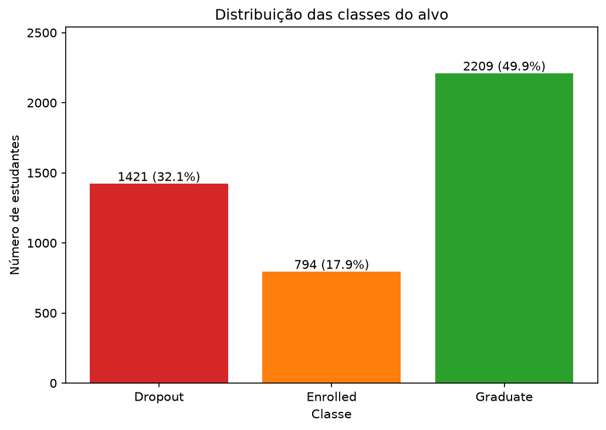
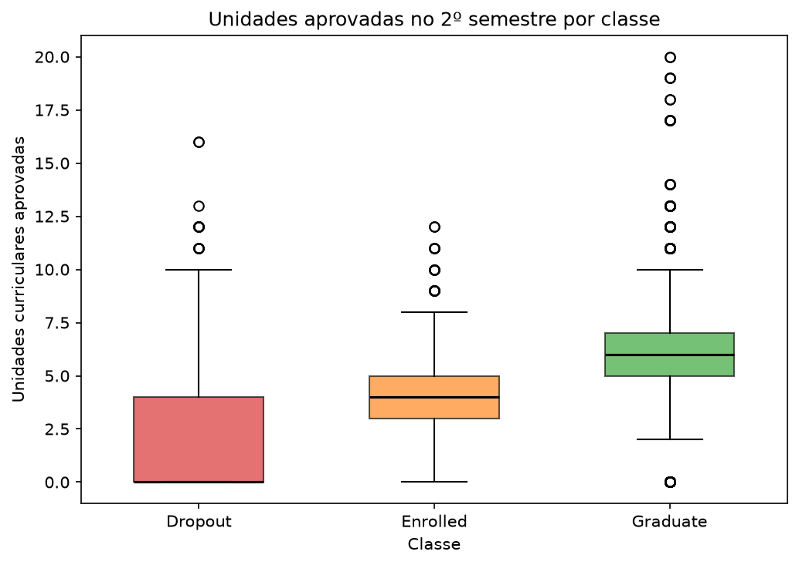
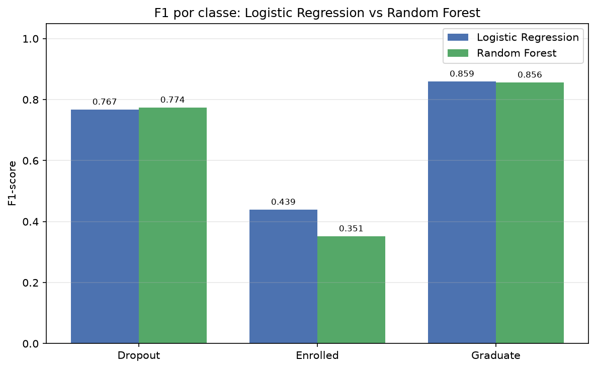

# EduPredict

Projeto educacional de Machine Learning que investiga se atributos disponíveis até o fim do 2º semestre permitem classificar o desfecho acadêmico de estudantes do ensino superior em `Dropout`, `Enrolled` ou `Graduate`. O estudo compara **Logistic Regression** e **Random Forest** de forma reproduzível, com foco no ciclo completo: dados, EDA, pré-processamento, treino, avaliação e seleção justificada.

> **Status:** concluído (Fases 0–7). É um exercício educacional e **não** deve orientar decisões reais sobre estudantes.

## Resultado em destaque

A métrica principal é o **F1 macro**, pois as classes são desbalanceadas e a acurácia é dominada por `Graduate` (~50%).

| Modelo | Acurácia | F1 macro | F1 weighted | Erros no teste |
|---|---|---|---|---|
| **Logistic Regression** | 0,7661 | **0,6882** | 0,7539 | **207** |
| Random Forest | 0,7616 | 0,6603 | 0,7388 | 211 |

| Classe | F1 — Logistic Regression | F1 — Random Forest |
|---|---|---|
| `Dropout` | 0,7670 | **0,7736** |
| `Enrolled` | **0,4387** | 0,3515 |
| `Graduate` | **0,8590** | 0,8557 |

**Modelo selecionado para este estudo: Logistic Regression.** A vantagem é modesta (Δ de 2,80 p.p. no F1 macro; 207 vs 211 erros em 885 exemplos), com um único split e sem tuning. O Random Forest tem F1 ligeiramente maior em `Dropout`; a Logistic Regression equilibra melhor `Enrolled`, a classe mais difícil. Não há alegação de superioridade universal. Detalhes em [`reports/comparison.md`](reports/comparison.md).

## Dataset

- **Fonte:** [Predict Students' Dropout and Academic Success](https://archive.ics.uci.edu/dataset/697/predict+students+dropout+and+academic+success) (UCI ID 697), CC BY 4.0, DOI [10.24432/C5MC89](https://doi.org/10.24432/C5MC89).
- **Dimensão:** 4.424 estudantes × 37 colunas (36 atributos + `Target`), sem valores ausentes ou duplicatas.
- **Atributos usados:** 33 (21 de perfil/candidatura, 6 do 1º semestre e 6 do 2º semestre). Os 3 indicadores macroeconômicos (`Unemployment rate`, `Inflation rate`, `GDP`) foram excluídos por incerteza sobre a disponibilidade temporal no momento da previsão.
- **Classes:** `Dropout` 1.421 (32,12%), `Enrolled` 794 (17,95%) e `Graduate` 2.209 (49,93%).
- **Momento da previsão:** fim do 2º semestre. O desfecho só é conhecido ao fim da duração normal do curso, de modo que os atributos precedem o alvo (sem vazamento temporal).

Dicionário completo, integridade dos arquivos, justificativas e a alternativa descartada (UCI ID 320) estão em [`data/README.md`](data/README.md).

## Análise exploratória

Relatórios em [`reports/eda_findings.md`](reports/eda_findings.md) e [`reports/eda_stats.md`](reports/eda_stats.md); figuras em [`reports/figures/`](reports/figures/).

- As três classes são desbalanceadas: um classificador que sempre prevê `Graduate` acertaria ~49,9%.
- Aprovações e notas do 2º semestre separam fortemente as classes (mediana de aprovadas: 0 / 4 / 6).
- Mensalidades em atraso e dívida associam-se a mais `Dropout`; bolsa associa-se a mais `Graduate` (associações, não causalidade).
- Variáveis semestrais são fortemente correlacionadas entre si (`enrolled` r = 0,94; `approved` r = 0,90).





## Pré-processamento

Implementação em [`src/preprocessing.py`](src/preprocessing.py); decisões em [`reports/preprocessing.md`](reports/preprocessing.md).

- Split 80/20 estratificado, `random_state=42`, antes de qualquer ajuste: 3.539 treino / 885 teste.
- 24 atributos numéricos padronizados com `StandardScaler`; 9 nominais com `OneHotEncoder(handle_unknown="ignore")`.
- 233 colunas após a transformação; `fit_transform` apenas no treino e `transform` no teste.
- Sem imputação (não há ausentes) e sem reamostragem; nenhuma sobreposição de índices entre treino e teste.

## Modelos

Ambos são baselines sem tuning de hiperparâmetros, usando a mesma divisão, os mesmos atributos e o mesmo pré-processador.

- **Logistic Regression** (`src/train_logistic_regression.py`): `C=1.0`, `solver="lbfgs"`, `max_iter=2000`, `class_weight=None`, `random_state=42`; convergiu em 109 iterações. Relatório: [`reports/model1_logistic_regression.md`](reports/model1_logistic_regression.md).
- **Random Forest** (`src/train_random_forest.py`): 100 árvores, `criterion="gini"`, `max_depth=None`, `max_features="sqrt"`, `class_weight=None`, `random_state=42`, `n_jobs=-1`. Relatório: [`reports/model2_random_forest.md`](reports/model2_random_forest.md).
- **Avaliação compartilhada** (`src/evaluation.py`): acurácia, precisão/recall/F1 macro e weighted, métricas por classe, matriz de confusão e JSON.



## Limitações

- Um único split 80/20; não há validação cruzada, intervalos de confiança nem repetição.
- Modelos de referência, sem ajuste de hiperparâmetros.
- `Enrolled` tem desempenho fraco nos dois modelos, por ser um estado intermediário ambíguo.
- Dados observacionais de uma única instituição; sem validação externa; associações não são causais.
- Os indicadores macroeconômicos foram excluídos; reavaliá-los exigiria outro momento de previsão.
- O projeto não salva artefatos de modelo (`models/` vazio): não há deploy nem uso em produção.

## Como reproduzir

**Ambiente testado:** Python 3.13.15 (Windows). As dependências diretas estão fixadas em [`requirements.txt`](requirements.txt).

```powershell
python -m venv .venv
.\.venv\Scripts\activate
python -m pip install -r requirements.txt
```

Em Linux/macOS, use `source .venv/bin/activate`. Em Windows com OneDrive, criar o `.venv` fora da pasta sincronizada evita lentidão.

O dataset já está versionado em `data/raw/dropout_academic_success/data.csv` (CC BY 4.0). Verifique a integridade:

```powershell
Get-FileHash -Algorithm SHA256 -LiteralPath "data/raw/dropout_academic_success/data.csv"
```

SHA-256 esperado: `3EF126DE5CEFFF26EB11FBB4237F1A1401CB64B488E2F1D598C23CEDEB4C45AE`. Se precisar baixar novamente, siga [`data/README.md`](data/README.md).

Execute os scripts na ordem:

```powershell
python src/inspect_dataset.py
python src/eda.py
python src/preprocessing.py
python src/train_logistic_regression.py
python src/train_random_forest.py
python src/compare_models.py
```

Saídas esperadas:

- `reports/dataset_overview.md`, `reports/eda_stats.md` e 5 figuras de EDA.
- `reports/preprocessing.md` (3.539/885 linhas; 233 colunas).
- `reports/model1_logistic_regression.md`, `reports/model2_random_forest.md`, seus JSONs e matrizes de confusão.
- `reports/comparison.md` e a figura comparativa; a última linha impressa deve indicar `Selecionado: Logistic Regression`.

As métricas gravadas nos JSON são determinísticas com as versões fixadas e `random_state=42`. Pequenas diferenças de ambiente (Python/SO/BLAS) podem alterar representações de ponto flutuante ou metadados, mas não o procedimento.

## Estrutura do repositório

```text
EduPredict/
├── data/
│   ├── raw/dropout_academic_success/data.csv
│   └── README.md
├── notebooks/                    # reservado; a EDA é feita por script
├── src/
│   ├── inspect_dataset.py
│   ├── eda.py
│   ├── preprocessing.py
│   ├── evaluation.py
│   ├── train_logistic_regression.py
│   ├── train_random_forest.py
│   └── compare_models.py
├── reports/
│   ├── figures/
│   ├── dataset_overview.md
│   ├── eda_findings.md
│   ├── eda_stats.md
│   ├── preprocessing.md
│   ├── model1_logistic_regression.md
│   ├── model1_metrics.json
│   ├── model2_random_forest.md
│   ├── model2_metrics.json
│   └── comparison.md
├── models/                       # vazio: sem deploy
├── LICENSE
├── README.md
├── requirements.txt
├── .gitattributes
└── .gitignore
```

## Etapas do projeto

| Fase | Descrição | Status |
|---|---|---|
| 0 | Definição do projeto e estrutura inicial | [x] |
| 1 | Escolha, obtenção e entendimento do dataset | [x] |
| 2 | Análise exploratória de dados (EDA) | [x] |
| 3 | Preparação e pré-processamento | [x] |
| 4 | Treinamento do Modelo 1: Logistic Regression | [x] |
| 5 | Treinamento do Modelo 2: Random Forest Classifier | [x] |
| 6 | Comparação e escolha do modelo | [x] |
| 7 | Organização final e publicação no GitHub | [x] |

## Uso de IA

Este projeto foi desenvolvido como exercício acadêmico com assistência de ferramentas de IA para apoio à implementação, à análise e à redação. O autor revisou, validou e assume responsabilidade por todo o conteúdo, em conformidade com as regras acadêmicas aplicáveis.

## Licença e citação

- **Código:** [MIT](LICENSE), © 2026 Lucas Campos.
- **Dados:** [CC BY 4.0](https://creativecommons.org/licenses/by/4.0/legalcode), © autores originais. A redistribuição exige atribuição; detalhes em [`data/README.md`](data/README.md).

```text
Realinho, V., Vieira Martins, M., Machado, J., & Baptista, L. (2021).
Predict Students' Dropout and Academic Success [Dataset].
UCI Machine Learning Repository. https://doi.org/10.24432/C5MC89
```
