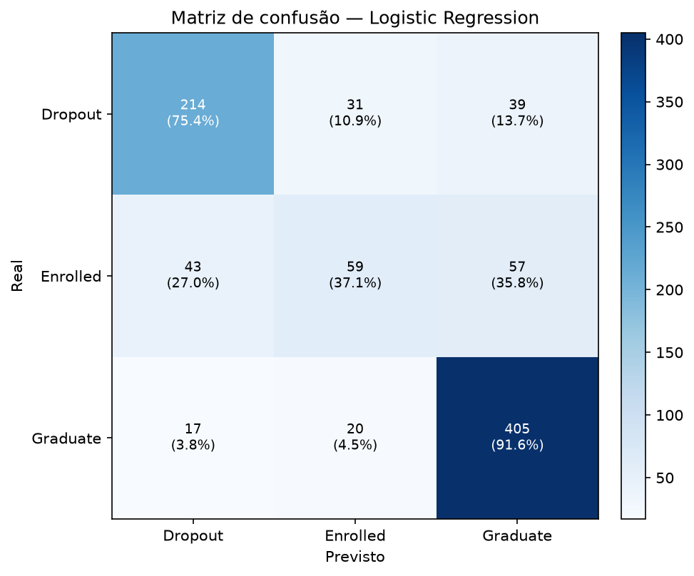

# Logistic Regression — Modelo 1

Gerado por `src/train_logistic_regression.py`. Resultados reais no conjunto de teste.

## Configuração

- Algoritmo: Logistic Regression.
- Hiperparâmetros: `C=1.0`, `solver='lbfgs'`, `max_iter=2000`, `class_weight=None`, `random_state=42`.
- Observação: `penalty` não é passado (depreciado no scikit-learn 1.8+); o padrão é L2.
- Pré-processamento: o mesmo `ColumnTransformer` da Fase 3, ajustado somente no treino.
- Divisão: 3539 treino / 885 teste (estratificada, seed 42).
- Ambiente: Python 3.13.15, scikit-learn 1.9.1.

## Convergência

- Iterações até parar: 109 de 2000.
- Convergiu sem aviso: sim.

## Métricas no conjunto de teste

| Métrica | Valor |
|---|---|
| Acurácia | 0.7661 |
| Macro | precisão 0.7086 · recall 0.6803 · F1 0.6882 |
| Weighted | precisão 0.7507 · recall 0.7661 · F1 0.7539 |

A média **macro** trata as classes com peso igual; a **weighted** pondera pelo suporte de cada classe. Ambas são registradas para não depender apenas da acurácia.

Referência: um classificador que sempre prevê a classe majoritária (`Graduate`) obteria acurácia de 49.94% no teste.

## Métricas por classe

| Classe | Precisão | Recall | F1 | Suporte |
|---|---|---|---|---|
| `Dropout` | 0.7810 | 0.7535 | 0.7670 | 284 |
| `Enrolled` | 0.5364 | 0.3711 | 0.4387 | 159 |
| `Graduate` | 0.8084 | 0.9163 | 0.8590 | 442 |

## Matriz de confusão

Contagens com percentual em relação ao total da linha (classe real):

| Real \ Previsto | Dropout | Enrolled | Graduate |
|---|---|---|---|
| `Dropout` | 214 (75.4%) | 31 (10.9%) | 39 (13.7%) |
| `Enrolled` | 43 (27.0%) | 59 (37.1%) | 57 (35.8%) |
| `Graduate` | 17 (3.8%) | 20 (4.5%) | 405 (91.6%) |

## Limitações

- Modelo de referência, sem ajuste de hiperparâmetros nem reamostragem.
- Desbalanceamento real pode reduzir o recall das classes minoritárias.
- Coeficientes não devem ser interpretados como efeito causal.
- Não deve ser usado para decisões reais sobre estudantes.

Métricas em JSON: `reports/model1_metrics.json`.
