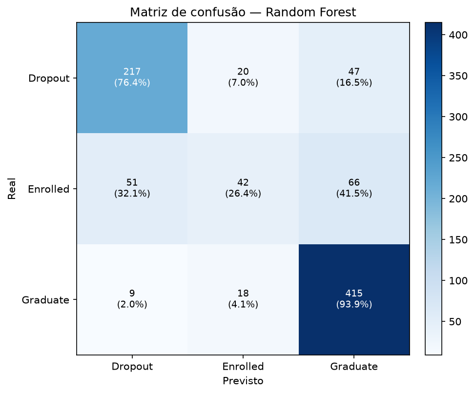

# Random Forest Classifier — Modelo 2

Gerado por `src/train_random_forest.py`. Resultados reais no conjunto de teste.

## Configuração

- Algoritmo: Random Forest Classifier.
- Hiperparâmetros: `n_estimators=100`, `criterion=gini`, `max_depth=None`, `min_samples_split=2`, `min_samples_leaf=1`, `max_features=sqrt`, `bootstrap=True`, `class_weight=None`, `random_state=42`, `n_jobs=-1`.
- Pré-processamento: o mesmo `ColumnTransformer` da Fase 3, ajustado somente no treino.
- Divisão: 3539 treino / 885 teste (estratificada, seed 42).
- Ambiente: Python 3.13.15, scikit-learn 1.9.1.

## Observações

- Baseline sem ajuste de hiperparâmetros, para comparação justa com o Modelo 1.
- Mesma divisão e mesmos 33 atributos do Modelo 1.
- `StandardScaler` mantido por uniformidade; árvores não dependem de escala.

## Métricas no conjunto de teste

| Métrica | Valor |
|---|---|
| Acurácia | 0.7616 |
| Macro | precisão 0.6981 · recall 0.6557 · F1 0.6603 |
| Weighted | precisão 0.7383 · recall 0.7616 · F1 0.7388 |

A média **macro** trata as classes com peso igual; a **weighted** pondera pelo suporte de cada classe. Ambas são registradas para não depender apenas da acurácia.

Referência: um classificador que sempre prevê a classe majoritária (`Graduate`) obteria acurácia de 49.94% no teste.

## Métricas por classe

| Classe | Precisão | Recall | F1 | Suporte |
|---|---|---|---|---|
| `Dropout` | 0.7834 | 0.7641 | 0.7736 | 284 |
| `Enrolled` | 0.5250 | 0.2642 | 0.3515 | 159 |
| `Graduate` | 0.7860 | 0.9389 | 0.8557 | 442 |

## Matriz de confusão

Contagens com percentual em relação ao total da linha (classe real):

| Real \ Previsto | Dropout | Enrolled | Graduate |
|---|---|---|---|
| `Dropout` | 217 (76.4%) | 20 (7.0%) | 47 (16.5%) |
| `Enrolled` | 51 (32.1%) | 42 (26.4%) | 66 (41.5%) |
| `Graduate` | 9 (2.0%) | 18 (4.1%) | 415 (93.9%) |

## Limitações

- Modelo de referência, sem ajuste de hiperparâmetros nem reamostragem.
- Árvores podem sobreajustar o treino; o erro de treino não é medido nesta fase.
- Desbalanceamento real pode reduzir o recall das classes minoritárias.
- Importância de variáveis não é analisada nesta fase.
- Não deve ser usado para decisões reais sobre estudantes.

Métricas em JSON: `reports/model2_metrics.json`.
